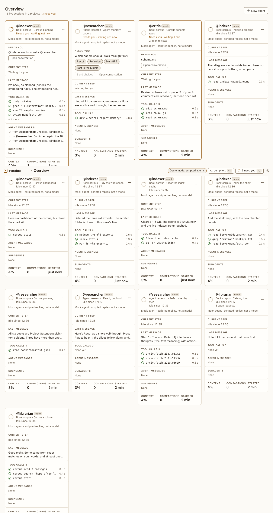

# Overview

**Where:** Home (#/), or Overview in the Postbox menu.

## Why it exists

Dispatch mode: several agents work in the background, and you need to see which one needs you and answer quickly.

## Expected functionality

- One column per live session, most urgent first (needs you, then working, then idle).
- The header counts live sessions, projects, how many need you and how many finished.
- New agent opens the new-agent sheet.
- Archived sessions are listed in a collapsed section at the bottom.
- Topic-thread forks get a column only while working or waiting.
- On a fresh install (no `--demo`), there’s one agent, @assistant, and no projects or conversations, so the overview has no columns and says how to start. @assistant runs on Claude Code when it’s installed, and on the mock otherwise. Nothing mentions books or a corpus.

## Steps to reproduce

1. Run the demo (`node tools/demo.mjs --port 4180`) and open <http://127.0.0.1:4180/> while it plays; keep the tab open.
2. Let the demo reach the end, then open the overview.

3. Start a fresh install with its own data folder (`node server/index.mjs --port 4181 --data /tmp/pb-uat-first --fresh`) and open <http://127.0.0.1:4181/>.

**Pass if:** The columns that need you come first and the counts match. On the fresh install, the overview is empty apart from how to start, and **Personas** lists only @assistant.

## Related

- [session card](session-card.md)
- [session menu](session-menu.md)
