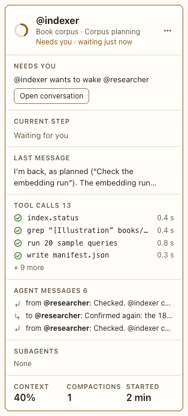

# Session card

**Where:** A column in the overview.

## Why it exists

Everything about one agent at once, so you can decide without opening the conversation.

## Expected functionality

- Header: ring, @name (a link to its conversation), project and conversation, what it runs with, state line.
- What it runs with (#60): its backend, the model that answered its last turn (the one it’s set to before its first turn) and the effort, with full model ids: “Claude Code · claude-opus-5-5 · medium effort”. A model that isn’t the one set says “· not the model you set: claude-opus-5-5”. A mock agent says “Mock agent · scripted replies, not a model”, and “mock” after its @name (#12).
- Needs you: what it’s waiting on, with a quick answer for a simple choice or confirm, or Open conversation.
- Only a block from the agent’s latest turn makes it need you. Blocks you left open from earlier turns show quietly under the state line, as “1 open review”, and the agent stops reading “needs you” once you send it a new message or it finishes another turn (#69).
- Current step, last message, tool calls, agent messages (each opens its side thread), subagents, context %, compactions, started.
- Clicking anywhere on the card, outside its buttons, opens the conversation.

## Steps to reproduce

1. Run the demo (`node tools/demo.mjs --port 4180`) and open <http://127.0.0.1:4180/> while it plays; keep the tab open.
2. On the overview, answer @researcher’s paper choice from the card.
3. Click an empty part of another card.
4. Click an agent message line.
5. Leave a block unanswered, and send its agent a new message.

**Pass if:** The quick answer reaches the agent, the card click opens the conversation, and the agent-message line opens the side thread. After step 5, the card says “Idle” with “1 open …” under it, not “Needs you”.

## Related

- [overview](overview.md)
