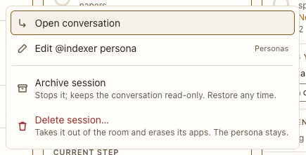

# Session menu

**Where:** “⋯” on a session card.

## Why it exists

Lets you stop, archive or delete a session without opening it.

## Expected functionality

- Open conversation, Edit persona, Stop (while it works), Archive session, Delete session….
- Edit persona says what the agent runs with, as its card does (#60).
- Archive shows a toast with Restore; Delete opens the [delete confirm](../sheets/delete-session.md).

## Steps to reproduce

1. Run the demo (`node tools/demo.mjs --port 4180`) and open <http://127.0.0.1:4180/> while it plays; keep the tab open.
2. Open the menu on a card and archive the session; restore it from the toast.

**Pass if:** Archive and Restore both take effect immediately.
