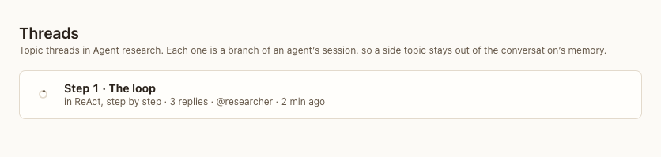

# Threads view

**Where:** Threads in the rail (#/p/<project>/threads).

## Why it exists

Topic threads stay findable after you close the panel; each is a branch of an agent’s memory.

## Expected functionality

- Lists the project’s topic threads, newest reply first, with the conversation, reply count, agents and when.
- Each opens the thread in the panel beside its conversation.
- An empty state explains how to start one.

## Steps to reproduce

1. Run the demo (`node tools/demo.mjs --port 4180`) and open <http://127.0.0.1:4180/> while it plays; keep the tab open.
2. After the demo, open Agent research › Threads, and open the thread.

**Pass if:** The thread opens in the panel with its replies.

## Related

- [topic thread panel](../conversation/panels/topic-thread-panel.md)
