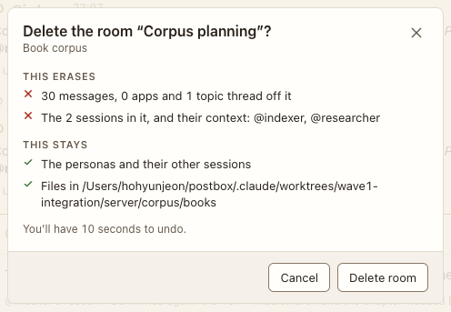

# Delete conversation

**Where:** Conversation menu › Delete….

## Why it exists

Deleting must say what goes and what stays, once, before it happens. Delete is just delete (designs/rooms-at-scale.md, “Delete”).

## Expected functionality

- Lists what’s erased (messages, apps, threads, sessions) and what stays (personas, files), and says it can’t be undone. After the confirm it’s gone at once.

## Steps to reproduce

1. Run the demo (`node tools/demo.mjs --port 4180`) and open <http://127.0.0.1:4180/> while it plays; keep the tab open.
2. Delete a conversation.

**Pass if:** The confirm says what goes and that it can’t be undone, and the conversation disappears at once, with no Undo toast.
