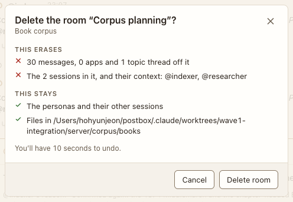

# Delete conversation

**Where:** The room’s Manage button (the gear after its title) › Delete…; Settings › Rooms, a row picked, then −; or `/delete` in the composer (#1735). From the main menu the confirm opens over it: Cancel returns to where you were in it, and it closes once the conversation is gone.

## Why it exists

Deleting must say what goes and what stays, once, before it happens. Delete is just delete.

## Expected functionality

- Lists what’s erased (messages, apps, threads, sessions) and what stays (personas, files), and says it can’t be undone. After the confirm it’s gone at once.
- A long project folder wraps inside the confirm, even with no space or hyphen in it, rather than widening it past a narrow window (#1534).
- When the confirm’s body doesn’t fit the window and scrolls, Tab reaches the body, and the arrow keys scroll it. When it fits, Tab goes from the close button to the buttons, with no extra stop (#1534; every dialog body does the same).

## Steps to reproduce

1. Run the demo (`node tools/demo.mjs --port 4180`) and open <http://127.0.0.1:4180/> while it plays; keep the tab open.
2. Delete a conversation.

3. Make a folder with a long name and no space or hyphen in it, such as `mkdir "/tmp/$(printf 'a%.0s' {1..120})"`, add it as a project under Settings › Projects, and start a conversation in it. Narrow the window to about 375 px wide, and open its Delete… (the gear after its title, then Delete…).
4. With the confirm still open, make the window short (about 400 px), so its body scrolls. Press Tab until the focus ring is on the body, then press the down arrow.
5. Make the window tall again, close the confirm, open it again, and press Tab from the close button.

**Pass if:** The confirm says what goes and that it can’t be undone, and the conversation disappears at once, with no Undo toast. In step 3 the folder’s name wraps inside the confirm and nothing scrolls sideways. In step 4 the body takes focus and scrolls with the arrow keys. In step 5 Tab goes from the close button straight to the buttons.
