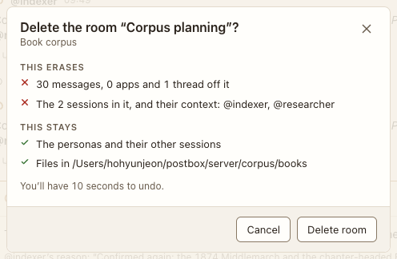

# Delete conversation

**Where:** Conversation menu › Delete….

## Why it exists

Deleting must say what goes and what stays, and be undoable.

## Expected functionality

- Lists what’s erased (messages, apps, threads, sessions) and what stays (personas, files); 10 seconds of Undo.

## Steps to reproduce

1. Run the demo (`node tools/demo.mjs --port 4180`) and open <http://127.0.0.1:4180/> while it plays; keep the tab open.
2. Delete a conversation, then Undo from the toast.

**Pass if:** The conversation disappears and comes back with Undo.
