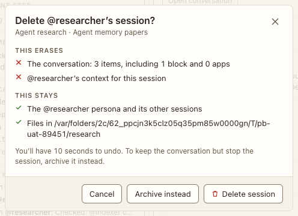

# Delete session

**Where:** `@handle /delete` in the composer, or `/delete` for the agent it replies to (#320).

## Why it exists

Removing one agent from a room keeps the room readable.

## Expected functionality

- Alone in its conversation, the agent’s session goes with the conversation: the confirm lists what goes, says it can’t be undone, and offers Cancel and Delete session, not Archive instead (#320).
- In a room, it isn’t a delete: the confirm is “Remove researcher from Index planning?”, with what ends and what stays, and offers Cancel and Remove researcher. The agent leaves at once, and its messages stay as they were, under its name, with no mark (#1743).

## Steps to reproduce

1. Run the demo (`node tools/demo.mjs --port 4180`) and open <http://127.0.0.1:4180/> while it plays; keep the tab open.
2. In “Index planning”, a room, send `@researcher /delete` and confirm.
3. In a conversation with one agent, send `@<agent> /delete` and confirm.

**Pass if:** In step 2 the confirm reads as removing @researcher from the room, its row is gone at once with no Undo, and its earlier messages keep its name with no “(deleted)”. In step 3 the confirm lists what goes and says it can’t be undone, and the conversation goes.
