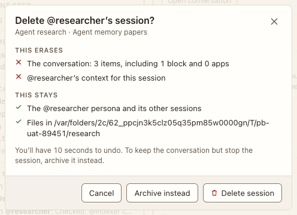

# Delete session

**Where:** An agent’s quick panel (its name in the sidebar’s Agents section) › Delete session… (#320).

## Why it exists

Removing one agent from a room keeps the room readable.

## Expected functionality

- In a room, the agent leaves and its messages stay marked “(deleted)”; alone, the conversation goes; 10 seconds of Undo.
- It offers Cancel and Delete session, not Archive instead: an agent’s session is archived only with its conversation (#320).

## Steps to reproduce

1. Run the demo (`node tools/demo.mjs --port 4180`) and open <http://127.0.0.1:4180/> while it plays; keep the tab open.
2. Delete @researcher’s session in “Corpus planning”, then Undo.

**Pass if:** Undo restores the session.
