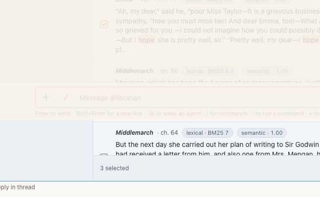

# Project folder picker

**Where:** + › From the project folder; and, to add a folder an agent may work in, Add folder… in the [permissions panel](../shell/permissions-panel.md).

## Why it exists

Attach project files by reference without uploading.

## Expected functionality

- Browses the project’s root folder only; Up, Open, Attach.
- From the permissions panel it’s “Add a folder”: it lists folders only, with Add on each and “Add this folder” for the one you’re in (#66). Escape closes the picker and leaves the panel open.
- Opens with focus on the first entry, and Open moves focus to the first entry of that folder. Escape returns focus to the + button (#26).

## Steps to reproduce

1. Run the demo (`node tools/demo.mjs --port 4180`) and open <http://127.0.0.1:4180/> while it plays; keep the tab open.
2. Attach a book file and send it.

**Pass if:** The file is attached as a reference.
