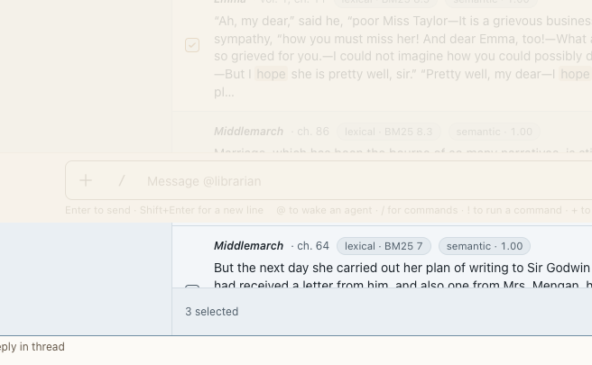

# Project folder picker

**Where:** + › From the project folder; and, to add a folder an agent may work in, Add folder… in the [permissions panel](../shell/permissions-panel.md).

## Why it exists

Attach project files by reference without uploading.

## Expected functionality

- Browses the project’s root folder only; Up, Open, Attach.
- From the permissions panel it’s “Add a folder”: it lists folders only, with Add on each and “Add this folder” for the one you’re in (#66). Escape closes the picker and leaves the panel open.
- Opens with focus on the first entry, and Open moves focus to the first entry of that folder. Escape returns focus to the + button (#26).
- A name with a control character, or one that reorders text or shows as nothing (such as a right-to-left override), shows each such character as the replacement mark (�), in the list, in its button’s name and in the folder line at the top; Attach, Open and Add still use the file’s real path, and sending a file attached so is refused, since its path holds such a character (#1046). Pointing at such a row shows its title, which names each character the marks stand for, such as “Contains U+202E” (#1052).

## Steps to reproduce

1. Run the demo (`node tools/demo.mjs --port 4180`) and open <http://127.0.0.1:4180/> while it plays; keep the tab open.
2. Attach a book file and send it.
3. In the project’s folder, make a file whose name is `a`, then U+202E, then `b.txt` (in a shell: `touch "a$(printf '\u202e')b.txt"`), and open the picker again.

**Pass if:** The file is attached as a reference, and the file from step 3 is listed as “a�b.txt”, not reordered; attaching and sending it shows “Your message didn’t send” with ““a_b.txt” can’t be attached”, and nothing is sent.
