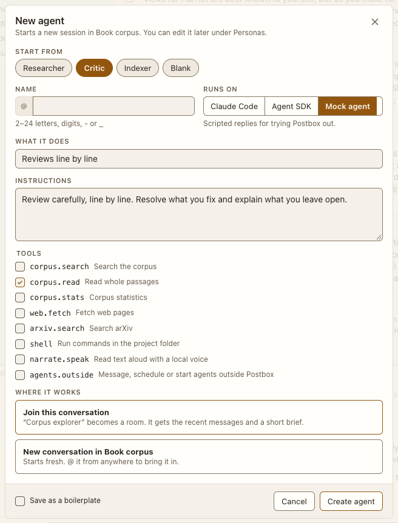

# New agent sheet

**Where:** + › From a boilerplate, or the conversation’s ⋯ › Add an agent….

## Why it exists

Creating agents happens in the app, with clear control over where they run and what they may do.

## Expected functionality

- Start from a boilerplate; name; runs on, a dropdown (Claude Code, Agent SDK, Kiro CLI, Antigravity CLI, Mock agent; one this computer can’t run is listed, disabled, as “not on this computer”); model; effort (Low, Medium, High, Extra high, Max; Medium by default), next to the model on real backends (#60); permissions (Auto default, Ask me, Accept edits, Run everything); folder; description; instructions; tools.
- On Claude Code or the Agent SDK, two checkboxes with help text: “Uses your Claude Code setup” (on by default; off is Isolated: the project’s settings, plus the folder’s local settings file, where Always allow saves its rules) and “Can publish outside Postbox” (off by default; on allows artifacts and connectors that post or send). Each works with Space or Enter. The mock agent doesn’t show them.
- Under them, “MCP servers” lists your servers: the ones in your Claude Code config (user, project and local scopes) and the claude.ai connectors and plugin servers your agents’ latest turn reported, by name only. Each has a checkbox, on by default, and its status from that turn (“Connected”, “Couldn’t connect”, “Needs sign-in”, or “Not started yet”). Unticked, the server doesn’t load for this agent. With “Uses your Claude Code setup” off, a line says only Postbox’s own server loads (#59).
- Tools: on Claude Code and the Agent SDK, an unticked tool is turned off for the agent (`shell` stops commands, `web.fetch` stops fetching and searching the web), and a line under the list says so. A ticked one still follows its permissions. `agents.outside` (“Message, schedule or start agents outside Postbox”) is off unless ticked (#5).
- Where it works: “Join this conversation” (a direct message becomes a room; a room gains an agent; from a topic thread’s +, “Join this topic thread”) or “New conversation in <project>”. The sheet says “conversation”, never “thread” (#4). Errors show inline.
- Space or Enter on a Tools checkbox, a setup checkbox, a boilerplate or the Runs on dropdown keeps focus on that control as the sheet updates (#26).

## Steps to reproduce

1. Run the demo (`node tools/demo.mjs --port 4180`) and open <http://127.0.0.1:4180/> while it plays; keep the tab open.
2. Create “@tester” from the Critic boilerplate and join the conversation.
3. Try an invalid name (“1x”).

**Pass if:** The agent joins, and the invalid name shows an inline error.
