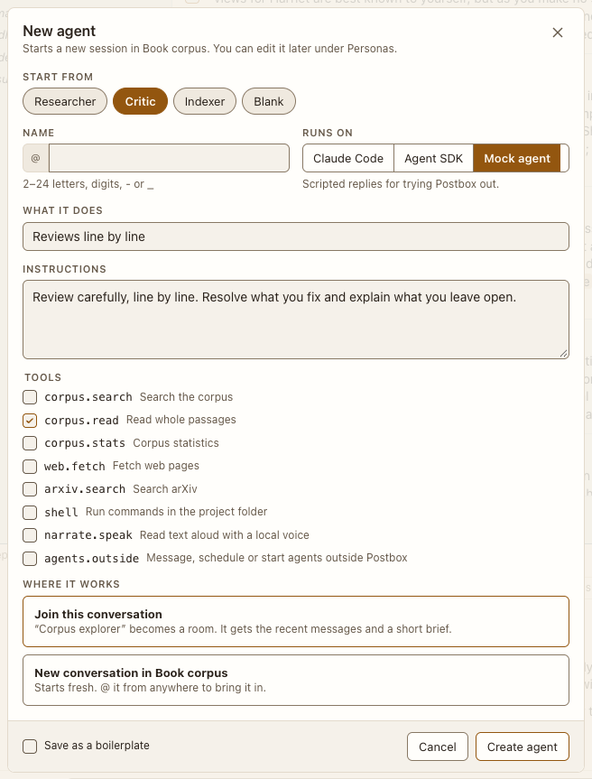

# New agent sheet

**Where:** + › From a boilerplate, the conversation’s ⋯ › Add an agent…, or Settings › Personas, New agent or a “Start from a boilerplate” chip.

## Why it exists

Creating agents happens in the app, with clear control over where they run and what they may do.

## Expected functionality

- The GPT boilerplate fills in general assistant instructions and selects Codex when available, using its first reported model or the backend default when its catalog is empty or unavailable. The backend default is labeled “Codex’s default” in status and the model picker, and does not cause a mismatch warning once Codex reports the model that answered. Codex omits an inherited Claude model, including the runtime’s default, from its thread and turn requests unless its catalog explicitly offers that model. Unknown non-Claude model choices still reach Codex so their errors stay visible. If Codex is unavailable, your current backend stays selected. New built-in boilerplates appear after restarting existing installations.
- Start from a boilerplate (Researcher, Critic, Developer, Gemini, GPT, Scrum master, Blank, and any you saved; it starts on Blank; picking Gemini selects the Antigravity CLI when available and its preferred Gemini model, or `gemini-3.8-flash-high`, and disables the chip with “Antigravity CLI not on this computer” when unavailable); name; runs on, a dropdown (Claude Code, Agent SDK, Kiro CLI, Antigravity CLI, Codex, Mock agent; one this computer can’t run is listed, disabled, as “not on this computer”); model; effort (Low, Medium, High, Extra high, Max; Medium by default), next to the model on real backends (#60); permissions (Auto (the harness judges), the default, or Run everything); folder; description; instructions; tools.
- Model: the field suggests the models the backend’s own harness lists, asked when the sheet opens or the backend changes, never a list of Postbox’s own. A new agent starts on `claude-opus-5-5` while the backend lists it, or hasn’t listed yet, and otherwise on the first model it lists. Any model you type is kept, listed or not, and the agent runs it as its `--model`. Only switching backend changes it, to the new backend’s default, when that backend doesn’t offer it. While the harness is asked, the field says “Asking <backend> for its models…”. When it can’t list, the field says so and suggests the models it listed last, if any.
- On Claude Code or the Agent SDK, two checkboxes with help text: “Uses your Claude Code setup” (on by default; off is Isolated: the project’s settings, plus the folder’s local settings file, where Always allow saves its rules) and “Can publish outside Postbox” (off by default; on allows artifacts and connectors that post or send). Each works with Space or Enter. The mock agent doesn’t show them.
- Under them, “MCP servers” lists your servers: the ones in your Claude Code config (user, project and local scopes) and the claude.ai connectors and plugin servers your agents’ latest turn reported, by name only. Each has a checkbox, on by default, and its status from that turn (“Connected”, “Couldn’t connect”, “Needs sign-in”, or “Not started yet”). Unticked, the server doesn’t load for this agent. With “Uses your Claude Code setup” off, a line says only Postbox’s own server loads (#59).
- Tools: on Claude Code and the Agent SDK, an unticked tool is turned off for the agent (`shell` stops commands, `web.fetch` stops fetching and searching the web), and a line under the list says so. A ticked one still follows its permissions. `agents.outside` (“Message, schedule or start agents outside Postbox”) is off unless ticked (#5).
- Where it works: “Join this conversation” (a direct message becomes a room; a room gains an agent; from a topic thread’s +, “Join this topic thread”) or “New conversation in <project>”. The sheet says “conversation”, never “thread” (#4). Errors show inline. With no project yet (a fresh install), the subtitle says “Create a project to start a session with it.” and “Where it works” isn’t shown: the agent is created without a conversation.
- Space or Enter on a Tools checkbox, a setup checkbox, a boilerplate, the Backend dropdown or the Runs on dropdown keeps focus on that control as the sheet updates (#26).

## Steps to reproduce

1. Run the demo (`node tools/demo.mjs --port 4180`) and open <http://127.0.0.1:4180/> while it plays; keep the tab open.
2. Create “@tester” from the Critic boilerplate and join the conversation.
3. Try an invalid name (“1x”).

4. With real agents (step 2 of the README’s UAT pass), open + › From a boilerplate. Compare the Model field’s suggestions with what `claude` offers in its `/model` menu. Type `claude-sonnet-5-5[1m]`, then create the agent.

**Pass if:** The agent joins, and the invalid name shows an inline error. With real agents, the suggestions are the ones Claude Code offers, and the agent’s first turn runs the typed model.
