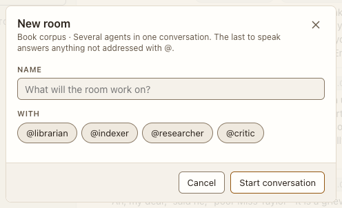

# New conversation and New room

**Where:** + beside Direct messages or Rooms.

## Why it exists

Rooms with several agents are created on purpose, not only by @-mentioning.

## Expected functionality

- Pick one agent for a direct message or two or more for a room; New room requires two.
- Enter or Space on an agent chip toggles it and keeps focus on the chip (#26).

## Steps to reproduce

1. Run the demo (`node tools/demo.mjs --port 4180`) and open <http://127.0.0.1:4180/> while it plays; keep the tab open.
2. Create a room with @indexer and @critic.
3. Try New room with one agent.

**Pass if:** The room is created and listed under Rooms; one agent shows “Pick at least two agents for a room.”
