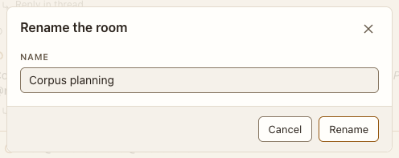

# Rename

**Where:** Conversation menu › Rename….

## Why it exists

Conversation names drift from what they turn into.

## Expected functionality

- Enter or Rename saves; an empty name is refused with a message.

## Steps to reproduce

1. Run the demo (`node tools/demo.mjs --port 4180`) and open <http://127.0.0.1:4180/> while it plays; keep the tab open.
2. Rename “Corpus planning” to “Planning”.

**Pass if:** The name changes in the top bar and rail.
