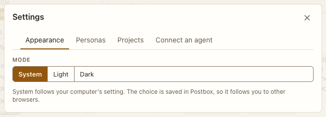

# Settings: Appearance

**Where:** Gear › Appearance.

## Why it exists

Light and dark, following the system unless you choose.

## Expected functionality

- System, Light, Dark; saved in Postbox; agent apps switch live.
- In dark mode, the chosen mode is an amber outline with an amber label, not a solid amber fill (#181). Light mode keeps its fill.

## Steps to reproduce

1. Run the demo (`node tools/demo.mjs --port 4180`) and open <http://127.0.0.1:4180/> while it plays; keep the tab open.
2. Switch to Dark with an app on screen.

**Pass if:** Postbox and the app switch at once.
