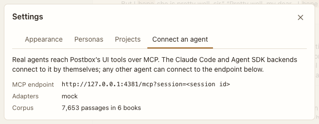

# Settings: Backends

**Where:** Gear › Backends.

## Why it exists

Shows which agent backends this Postbox can run, and how they reach Postbox’s UI tools.

## Expected functionality

- Lists the backends available here, and the corpus.
- Says that Postbox connects each backend it runs, with a token for each turn. There’s no endpoint to connect another agent with a session id alone: since #54, a tool call without the running turn’s token is refused, so a script that knows a session id can’t act as that agent.

## Steps to reproduce

1. Run the demo (`node tools/demo.mjs --port 4180`) and open <http://127.0.0.1:4180/> while it plays; keep the tab open.
2. Open the tab and compare the backends with the server’s startup log.

**Pass if:** The list matches, and no session-id-only endpoint is offered.
