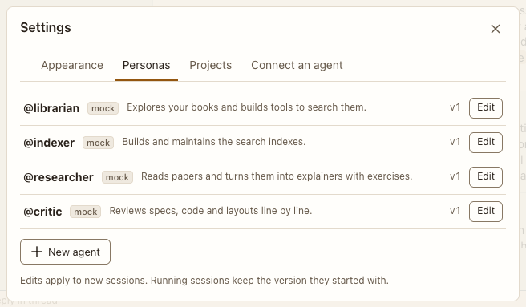

# Settings: Personas

**Where:** Gear › Personas, or Personas in the rail.

## Why it exists

Agents are edited in the app, in this one place. Every edit applies from each agent’s next turn, in every conversation it’s in; a turn that’s running keeps what it started with.

## Expected functionality

- Lists personas with Edit, and “mock” after the name of each that runs on the mock (#12); the editor ([screenshot](../../screenshots/settings-persona-editor.png)) changes description, instructions, runs on, model, effort (#60), permissions (Auto (the harness judges) or Run everything), folder and tools; Retire and Bring back. `/mode`, `/model` and `/effort` in the composer, and an agent’s name in the sidebar, open it.
- Under the list, “Start from a boilerplate” has one chip per boilerplate, built in or saved, in the New agent sheet’s order, except Blank: New agent beside it starts on Blank. A chip opens the [New agent sheet](../new-agent.md) with that boilerplate chosen, over Settings; closing the sheet puts focus back on the chip, and creating the agent closes Settings too. A boilerplate whose backend isn’t on this computer is disabled, with its reason, as in the sheet (“GPT (Codex not on this computer)”). `npx playwright test boilerplate-row` checks it on a fresh install.
- For Claude Code and the Agent SDK, the editor also has “Uses your Claude Code setup” (on by default) and “Can publish outside Postbox” (off by default). Like permissions, they apply to the persona’s conversations from their next turn. `npx playwright test persona-setup` checks both.
- Delete… asks once, says what goes and that it can’t be undone, then the persona goes at once, with its sessions and its memory.
- Under them, “MCP servers” lists your servers with their status from the persona’s latest turn, each with a checkbox, on by default. A server turned off doesn’t load for the persona, from its conversations’ next turn (#59). `npx playwright test runtime` (`tests/browser/runtime.spec.mjs`) checks the list, the keyboard and saving.
- On Claude Code and the Agent SDK, Tools are enforced: an unticked tool is turned off, and a ticked one still follows its permissions. Like permissions, changes reach the persona’s conversations from their next turn, and the save confirmation says so (#5).
- For a saved Claude Code or Agent SDK persona, Permissions… opens the [permissions panel](../../shell/permissions-panel.md) over the editor, with its rules in the folder of its latest conversation (#66). Escape closes the panel and keeps the editor.

## Steps to reproduce

1. Run Postbox with Claude Code (`node server/index.mjs --port 4181 --data /tmp/pb-uat-personas --fresh`) and open <http://127.0.0.1:4181/>. Start a conversation with an agent on Claude Code and send it a message.
2. Click its name in the sidebar: this sheet opens on it. Edit its effort to High and save.
3. Send it another message.

**Pass if:** The save confirmation says it applies from its next turn in every conversation; the next turn runs at high effort, and the row under its name says so once that turn has run.
