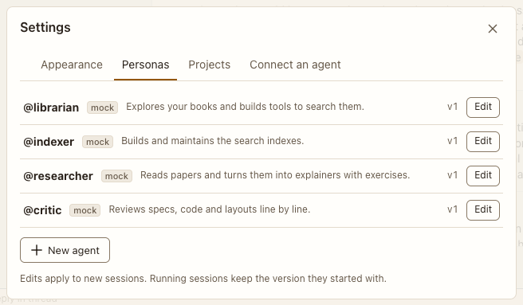

# Settings: Personas

**Where:** Gear › Personas, or Personas in the rail.

## Why it exists

Agents are edited in the app; edits apply to new sessions, and where an agent runs and its permissions apply from the next turn.

## Expected functionality

- Lists personas with Edit; the editor ([screenshot](../../screenshots/settings-persona-editor.png)) changes description, instructions, runs on, model, effort (#60), permissions, folder and tools; Retire and Bring back.
- For Claude Code and the Agent SDK, the editor also has “Uses your Claude Code setup” (on by default) and “Can publish outside Postbox” (off by default). Like permissions, they apply to the persona’s conversations from their next turn. `node tools/checks/persona-setup.mjs` checks both in headless Chrome.
- Under them, “MCP servers” lists your servers with their status from the persona’s latest turn, each with a checkbox, on by default. A server turned off doesn’t load for the persona, from its conversations’ next turn (#59). `node tools/check-runtime.mjs` checks the list, the keyboard and saving in headless Chrome.
- On Claude Code and the Agent SDK, Tools are enforced: an unticked tool is turned off, and a ticked one still follows its permissions. Like permissions, changes reach the persona’s conversations from their next turn, and the save confirmation says so (#5).
- For a saved Claude Code or Agent SDK persona, Permissions… opens the [permissions panel](../../shell/permissions-panel.md) over the editor, with its rules in the folder of its latest conversation (#66). Escape closes the panel and keeps the editor.

## Steps to reproduce

1. Run the demo (`node tools/demo.mjs --port 4180`) and open <http://127.0.0.1:4180/> while it plays; keep the tab open.
2. Edit @critic’s permissions to Ask me and save.

**Pass if:** The save confirmation says when it applies.
