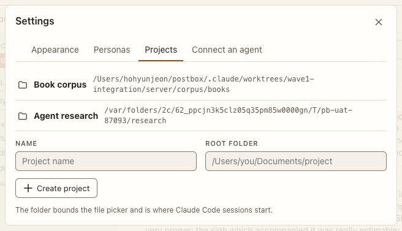

# Settings: Projects

**Where:** Gear › Projects, or New project… in the Postbox menu.

## Why it exists

Each project has one root folder, where agents start and the picker is bounded.

## Expected functionality

- Lists projects and folders; adds a project with a name and folder.
- Enter on a tab switches to it and keeps focus on the tab (#26).
- Archive idle conversations: after 1 day, 3 days, 7 days (the default), 30 days, or Never. A conversation where nothing has happened for that long, with nothing waiting on you or working, moves to [Archived](../../overview/archived-sessions.md) with its agents, in every project. Postbox looks at startup, every hour, and when you change it. Nothing is deleted (#101).

## Steps to reproduce

1. Run the demo (`node tools/demo.mjs --port 4180`) and open <http://127.0.0.1:4180/> while it plays; keep the tab open.
2. Add a project with a folder you own.
3. Choose “After 1 day” under Archive idle conversations, with a conversation you haven’t touched for a day.

**Pass if:** The project appears in the Postbox menu. After step 3, that conversation leaves the overview and the sidebar and is under Archived, and one that needs you stays.
