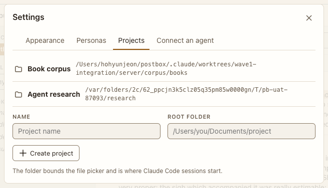

# Settings: Projects

**Where:** Gear › Projects, or New project… in the Postbox menu.

## Why it exists

Each project has one root folder, where agents start and the picker is bounded.

## Expected functionality

- Lists projects and folders; adds a project with a name and folder.
- Create project takes only a full path to a folder that exists (#547). An empty or relative Root folder is refused with “Couldn’t create the project” and says to write the folder’s full path; nothing is made in the folder Postbox was started from.
- Enter on a tab switches to it and keeps focus on the tab (#26).
- No idle archiving (#320): a conversation stays in the sidebar however long nothing happens in it. Its agents’ sessions are archived only with it, and deleted with it.

## Steps to reproduce

1. Run the demo (`node tools/demo.mjs --port 4180`) and open <http://127.0.0.1:4180/> while it plays; keep the tab open.
2. Choose Create project with Name and Root folder empty, then with `server` as the Root folder.
3. Add a project with a folder you own, by its full path.
4. Check there’s no Archive idle conversations setting, and that a conversation you haven’t touched for days is still in the sidebar.

**Pass if:** Both tries in step 2 are refused with a toast that says to write the folder’s full path, and no project is added; the project from step 3 appears in the Postbox menu; and in step 4 nothing has archived itself.
