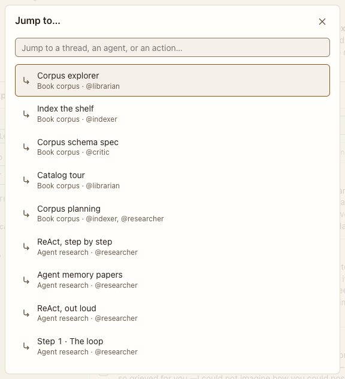

# Command palette

**Where:** Anywhere: ⌘K, or Jump to… in the top bar.

## Why it exists

With many conversations, typing a few letters is faster than scanning the rail.

## Expected functionality

- Opens with focus in the search field; lists conversations, agents and actions.
- Typing filters; arrows move; Enter opens; Escape closes and restores focus.

## Steps to reproduce

1. Run the demo (`node tools/demo.mjs --port 4180`) and open <http://127.0.0.1:4180/> while it plays; keep the tab open.
2. Press ⌘K, type “react”, press Enter.
3. Press ⌘K again and Escape.

**Pass if:** The conversation opens, and Escape returns focus where it was.
