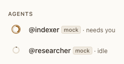

# Agents section

**Where:** In the sidebar, the open conversation’s Agents, above Direct messages. It’s the conversation’s only pool: one session per agent, with no forks (#228). A topic thread’s panel names who is in it in one line.

## Why it exists

The person needs to see what each agent runs with, from wherever they are. The chips crowded the top bar until the title read “UseCase - E…” (#105). A quick panel once changed model and effort for one conversation but mode and tools for the persona everywhere; the person found settings complex because they were inconsistent, and the sprints found the model, backend and effort shown weren’t the ones running. Then the person asked for simpler still: an agent’s name opens its persona sheet, the one place its settings change, and what an agent does is an `@handle /command` (designs/rooms-at-scale.md, “Settings: one scope”).

## Expected functionality

- One row per agent: its ring, `@handle` (“mock” after it on the mock), its state in words (“· idle”, “· calling tools”), and on a second line the model that answered its last turn and the effort (“Sonnet 5.5, not Opus 5.5 · medium effort”). A mock agent has no second line. Each part follows the agent live.
- An agent with blocks left open from earlier turns shows a quiet “1 open review” button under its row, which scrolls to the block and focuses it (#69).
- While an agent needs you, its ring goes to what it needs: its ask is scrolled into view, focused and outlined for a moment, in the side panel when it asked in a side or topic thread (#285). The ring is then a button of its own, “Go to what @handle needs”, one Tab stop before the name. Its name still opens its persona sheet (#320).
- Clicking an agent’s name, or Enter on it, opens Settings › Personas on its persona, the one place its settings change. Every change there applies from its next turn, in every conversation it’s in; a turn that’s running keeps what it started with. Escape closes it and returns focus to the row (designs/rooms-at-scale.md, “Settings: one scope”).
- There’s no quick panel. What an agent does is a command addressed to it in the composer: `@handle /stop` (while it works), `@handle /compact`, and `@handle /delete`, which asks once and then deletes its session at once ([delete session](../../sheets/delete-session.md)) (#320, #405).
- An agent the person never added says why under its row: “Joined when @indexer woke it” after the person allowed the card “Add @critic to this conversation?”, or “Joined when you @-mentioned it in a side thread” (or “in a thread”) (#228). An agent can’t bring one in without that card.
- **The agent tree** (#121, #228). Under an agent’s row, wrapped rather than cut: its turn when it answers in a side or topic thread (“Calling tools with @indexer”), with a Stop while it works, which opens that thread; hovering it shows which thread and who woke it. There are no forks: a wake for an agent that’s busy waits for its turn. One waiting for you counts in “needs you”, ⌃J and the tab title.
- **Subagents in the tree** (#73). While an agent’s subagents work, each is an entry under its row, nested under the subagent that started it: its ring, its name and what it was asked (“general-purpose · subagent: Reader”, or “subagent in the background” for one that works on after its call returned), and on a line of its own what it’s doing now: its latest narration in its own words, in quotes, followed by its current step once that has changed since (““The word count came back as 3.” · Nested checker”), else its current step, or “Thinking: …” in italics. All of it is on screen, not in a tooltip. Each leaves the tree when it ends.
- **End** (#229) on each subagent’s row, named “End @indexer’s subagent ‘Reader’”. Postbox can’t stop one subagent without stopping the whole turn, so End tells the agent, urgently: the person ended that subagent, so stop it with your own tools and don’t use its result. The agent hears it on its next Postbox tool result in the turn, or else at its next turn. The row reads “Ending: @indexer was told to stop it” until the subagent or the turn ends, and focus moves to the next subagent’s End, else the agent’s row.

## Steps to reproduce

1. Run the demo (`node tools/demo.mjs --port 4180`) and open <http://127.0.0.1:4180/> while it plays; keep the tab open.
2. Open “Corpus planning”. Check the Agents section above Direct messages.
3. Click @indexer’s name: its persona sheet opens. Change its effort, save, and send @indexer a message: that turn runs at the new effort.
4. Tab to a row, press Enter, and press Escape: focus is back on the row.
5. Send `@indexer /compact`, then `@indexer /delete` and Cancel.
6. Under an agent reply, choose Reply in thread, and ask something there. The conversation’s own agent answers; the thread’s panel names it in a line, and the sidebar lists no new agent.
7. Narrow the window to 375 px and check a topic thread’s panel.
8. In a room, ask @indexer to wake @researcher with a long task, and while @researcher works in the side thread, have @indexer wake it again: the second wake waits for its turn, with no fork. Check the tree under @researcher, the side-thread line, and `/stop` in the conversation.
9. With a real agent, ask it to use a subagent that starts its own subagent, and watch the tree under its row while they work. Tab to one’s End and press Enter: it reads “ending”, and the agent stops it.
10. Run `npx playwright test agents side-threads` (`tests/browser/agents.spec.mjs` and `side-threads.spec.mjs`).

**Pass if:** An agent’s name opens its persona sheet, a change there reaches its next turn, and `@handle /compact` and `/delete` act on that agent; the row works by keyboard and fits at 375 and 1280 px; an agent at work in a side or topic thread shows under its row with a Stop, and nothing else lists agents; each subagent at work shows under it with what it was asked and what it’s doing now, nested by who started it, with an End the agent obeys; and the checks pass.

## Related

- [rail](rail.md)
- [top bar](../top-bar/top-bar.md)
- [permissions panel](../permissions-panel.md)
- [topic thread panel](../../conversation/panels/topic-thread-panel.md)
