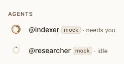

# Agents section

**Where:** In the sidebar, the open conversation’s Agents, above Direct messages. It’s the conversation’s only pool: one session per agent, with no forks (#228). A topic thread’s panel names who is in it in one line.

## Why it exists

The person needs to see what each agent runs with, from wherever they are. The chips crowded the top bar until the title read “UseCase - E…” (#105). A quick panel once changed model and effort for one conversation but mode and tools for the persona everywhere; the person found settings complex because they were inconsistent, and the sprints found the model, backend and effort shown weren’t the ones running. Then the person asked for simpler still: an agent’s name opens its persona sheet, the one place its settings change, and what an agent does is an `@handle /command`.

## Expected functionality

- **One button beside the Agents heading** (#1735), “Manage this conversation’s members”, opens the room’s form in the main menu at its Members list. Members are added and removed there, not here:
  - **+** lists the agents you have that aren’t in this conversation, each added in one pick, with a line in the conversation saying it joined, then New agent…. A retired agent isn’t listed.
  - **−** removes the member picked, through the room’s Remove confirm, which reads as leaving the room (#1743; described on the [Delete session](../../sheets/delete-session.md) page); its persona stays. While one agent is left, − is off and says why (“A room keeps at least one agent. Add another first, or delete the room.”), and it still takes focus. A person of this Postbox is in every room, so − is off for one and says so.
- One row per agent: its ring, its name without “@” (“mock” after it on the mock: “indexer mock · idle”), its state in words, and on a second line the model that answered its last turn and the effort (“Sonnet 5.5, not Opus 5.5 · medium effort”). Switched to another backend or model, it shows the new setting until a turn reports its own, never the model an earlier turn reported (#1315: Kiro on its router reports none, and its row kept saying “Opus 5.5, not auto”). A mock agent has no second line. Each part follows the agent live.
- **Its state** (#1403), read from its records, never from what it said, on the row’s one line, cut with an ellipsis, with the whole of it as the line’s tooltip. A change of state never changes the row’s size, so nothing moves under the pointer. The first that holds:
  - “· needs you”;
  - “· stopping”, after the person’s Stop, until the turn ends;
  - its current step while it runs (“· Running npm test”), on this computer or a host;
  - “· out of quota until 4:00 PM”, or “· out of quota” when its harness gave no reset time (#442);
  - “· failed”;
  - “· waiting on a job: Build the index”, while a background job it kept running after a Stop still runs;
  - “· idle”.
- An agent with blocks left open from earlier turns shows a quiet “1 open review” button under its row, which scrolls to the block and focuses it (#69).
- A need rings one person (#1742): the one who last wrote in the room, or who made it. On your own computer that is you, so nothing changes. Where Postbox knows more than one person, an agent that waits on someone else reads “waits on another person”, its ring shows the state without the pulse, and it isn’t counted in the title, reached by ⌃J or raised as a toast for you. `npx playwright test tests/browser/needs-for.spec.mjs` checks it.
- A reply that asks you makes its agent need you (#1742): the last reply of a turn that says `@you` in answer to your message, or names you by user name. Its ring pulses and it counts in the title and for ⌃J, as any need does, with no toast. Opening the room is reading it, and the need goes with nothing to press; so does writing there. With the room open as the reply lands, nothing rings; a room counts as open for about 20 seconds after you leave it. It stays until you read it, whatever the agent does next. `npx playwright test tests/browser/person-mentions.spec.mjs` checks the page, and `tests/person-mentions.test.mjs` the rule.
- While an agent needs you, its ring goes to what it needs: its ask is scrolled into view, focused and outlined for a moment, in the side panel when it asked in a topic thread, or a side thread from before #372 (#285). The ring is then a button of its own, “Go to what indexer needs”, one Tab stop before the name. Its name still opens its persona sheet (#320).
- Clicking an agent’s name, or Enter on it, opens Settings › Personas on its persona, the one place its settings change. Every change there applies from its next turn, in every conversation it’s in; a turn that’s running keeps what it started with. Escape closes it and returns focus to the row.
- There’s no quick panel. What an agent does is a command addressed to it in the composer: `@handle /stop` (while it works), `@handle /compact`, and `@handle /delete`, which asks once and then deletes its session at once ([delete session](../../sheets/delete-session.md)) (#320, #405).
- An agent the person never added says why under its row: “Joined when indexer woke it” after the person allowed the card “Add critic to this conversation?”, or “Joined when you @-mentioned it in a side thread” (or “in a thread”) (#228). An agent can’t bring one in without that card.
- **The agent tree** (#121, #228). Under an agent’s row, wrapped rather than cut: its turn when it answers in a topic thread, or in a side thread from before #372 (“Calling tools with indexer”, naming who woke it when another agent did), with a Stop while it works, which opens that thread; hovering it shows which thread and who woke it. Since #372 agents wake each other in the conversation, not in a side thread, so a wake adds no entry here. There are no forks: a wake for an agent that’s busy waits for its turn. One waiting for you counts in “needs you”, ⌃J and the tab title.
- **Subagents in the tree** (#73). While an agent’s subagents work, each is an entry under its row, nested under the subagent that started it: its ring, its name and what it was asked (“general-purpose · subagent: Reader”, or “subagent in the background” for one that works on after its call returned), and on a line of its own what it’s doing now: its latest narration in its own words, in quotes, followed by its current step once that has changed since (““The word count came back as 3.” · Nested checker”), else its current step, or “Thinking: …” in italics. All of it is on screen, not in a tooltip. Each leaves the tree when it ends.
- **End** (#229) on each subagent’s row, named “End indexer’s subagent ‘Reader’”. Postbox can’t stop one subagent without stopping the whole turn, so End tells the agent, urgently: the person ended that subagent, so stop it with your own tools and don’t use its result. The agent hears it on its next Postbox tool result in the turn, or else at its next turn. The row reads “Ending: indexer was told to stop it” until the subagent or the turn ends, and focus moves to the next subagent’s End, else the agent’s row.

## Steps to reproduce

1. Run the demo (`node tools/demo.mjs --port 4180`) and open <http://127.0.0.1:4180/> while it plays; keep the tab open.
2. Open “Index planning”. Check the Agents section above Direct messages.
3. Click @indexer’s name: its persona sheet opens. Change its effort, save, and send @indexer a message: that turn runs at the new effort. Then switch its Backend to the Kiro CLI with another model and effort, and save: its row names the new model and effort, with no “not”.
4. Tab to a row, press Enter, and press Escape: focus is back on the row.
5. Send `@indexer /compact`, then `@indexer /delete` and Cancel.
6. Under an agent reply, choose Reply in thread, and ask something there. The conversation’s own agent answers; the thread’s panel names it in a line, and the sidebar lists no new agent.
7. All by keyboard: press “Manage this conversation’s members” beside Agents. The room’s form opens in the main menu at Members. Press + and pick an agent not in the conversation: it’s added to Members, and its row appears in the sidebar with a line in the conversation saying it joined. Pick it in Members, press −, and confirm Remove: it leaves Members and the sidebar, and its persona stays. In a conversation with one agent, Tab to −: it says why it’s off, and Enter does nothing.
8. Narrow the window to 375 px and check a topic thread’s panel.
9. In “Index planning”, after scene 7, read the agents’ loop: they woke each other in the conversation, each reply saying “woken by” the agent that woke it, with no side thread and no fork. Then choose Reply in thread under a reply of @researcher’s and ask it something there: while it answers, its turn shows under its row with a Stop, and hovering it names the thread. Its Stop stops that turn; a `/stop` sent in the conversation doesn’t reach a topic thread’s turn. An entry for a side thread needs a conversation from before #372 with a turn running in one (`tests/browser/side-threads.spec.mjs` builds one).
10. With a real agent, ask it to use a subagent that starts its own subagent, and watch the tree under its row while they work. Tab to one’s End and press Enter: it reads “ending”, and the agent stops it.
11. Ask @indexer to start a long command in the background (`sleep 120`, run in the background) and keep working. While it works, press Stop, and in “@indexer has 1 background job running. Stop it too?” choose Keep running: its row says it’s waiting on that job until the job ends. A turn that ends on its own stops every job it didn’t keep, so without Keep running there’s no job to wait on. Ask it to @-mention @researcher while @researcher works: once its own turn ends, its row says idle, not that it waits behind @researcher, while the mention waits in @researcher’s inbox (#1975).
12. Run `npx playwright test agents agent-state side-threads agents-add-remove` (`tests/browser/agents.spec.mjs`, `agent-state.spec.mjs`, `side-threads.spec.mjs` and `agents-add-remove.spec.mjs`).

**Pass if:** Each row says its agent’s state as listed, at a steady size; an agent’s name opens its persona sheet, a change there reaches its next turn, a backend switch leaves no other backend’s model on its row, and `@handle /compact` and `/delete` act on that agent; the row works by keyboard and fits at 375 and 1280 px; an agent at work in a topic thread shows under its row with a Stop, and nothing else lists agents; each subagent at work shows under it with what it was asked and what it’s doing now, nested by who started it, with an End the agent obeys; and the checks pass.

## Related

- [rail](rail.md)
- [top bar](../top-bar/top-bar.md)
- [permissions panel](../permissions-panel.md)
- [topic thread panel](../../conversation/panels/topic-thread-panel.md)
