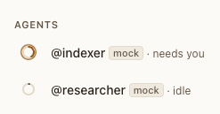
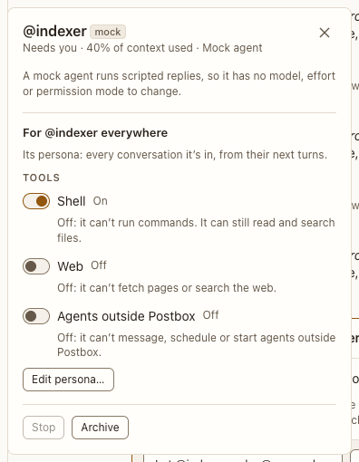

# Agents section and quick panel

**Where:** In the sidebar, the open conversation’s Agents, above Direct messages. It’s the conversation’s only pool: one session per agent, with no forks (#228). A topic thread’s panel names who is in it in one line. Each agent’s ring in the top bar opens the same quick panel.

## Why it exists

One agent’s settings were in four places: `/model`, `/effort` and `/mode` in the composer; rules, folders and MCP servers in the permissions panel; tools only in Settings › Personas; and its state in a top-bar chip. In #104 the person couldn’t tell that @critic’s shell was off, because the tools were two screens away. The chips also crowded the top bar until the title read “UseCase - E…”. A topic thread had no way to change any of it, because its composer has no `/` (#105).

## Expected functionality

- One row per agent: its ring, `@handle` (“mock” after it on the mock), its state in words (“· idle”, “· calling tools”), and on a second line the model that answered its last turn and the effort (“Sonnet 5.5, not Opus 5.5 · medium effort”). A mock agent has no second line. Each part follows the agent live.
- An agent with blocks left open from earlier turns shows a quiet “1 open review” button under its row, which scrolls to the block and focuses it (#69). The quick panel shows it too.
- Clicking a row, or Enter on it, opens its quick panel beside the row. In a narrow window it opens as a sheet, like any dialog. It’s a dialog named after the agent, and focus starts on its model.
- **In this conversation** (or **In this thread**): Model and Effort, as segmented choices. A choice takes effect from the agent’s next turn, as `/model` and `/effort` do, and only for this conversation’s session; a topic thread’s are its own.
- **For @handle everywhere**: Permission mode (Auto, Ask me, Accept edits, Run everything) and Tools (Shell, Web, Agents outside Postbox), which are the persona’s and apply to every conversation it’s in. Each tool is a switch that says On or Off in words, with what turning it off means under it (“Off: it can’t run commands. It can still read and search files.”).
- Every control’s name carries its scope too, so a screen reader hears it on the control: “Model, in this conversation”, “Shell, for @critic everywhere”.
- After a change, a line under the controls says what changed and when it takes effect (“Model: Sonnet 5.5 for @indexer in this conversation, from its next turn.”), and it’s announced.
- “Rules, folders and MCP…” opens the [permissions panel](../permissions-panel.md) on this agent (not on a Kiro agent, which doesn’t read them). “Edit persona…” opens Settings › Personas on it.
- Stop (only while it works; while its process exits it reads “stopping”, and Stop isn’t offered again; with background jobs running, it closes the panel and the conversation asks whether to stop them too), Compact (on a real backend, while idle; it runs `/compact` as the agent’s turn, as the composer’s `/compact` does) and Archive (with Restore in the toast).
- A mock agent says it has no model, effort or permission mode to change; its tools still show.
- By keyboard: each group of choices is one Tab stop; the arrow keys move within it, and Enter or Space picks. Space or Enter flips a switch. Escape closes the panel and returns focus to the row or ring it came from.
- Model and effort changed elsewhere (`/model`, another tab) show in the open panel at once.
- An agent the person never added says why under its row and on its ring in the top bar: “Joined when @indexer woke it” after the person allowed the card “Add @critic to this conversation?”, or “Joined when you @-mentioned it in a side thread” (or “in a thread”) (#228). An agent can’t bring one in without that card.
- **The agent tree** (#121, #228). Under an agent’s row, wrapped rather than cut: its turn when it answers in a side or topic thread (“Calling tools with @indexer”), with a Stop while it works, which opens that thread; hovering it shows which thread and who woke it. There are no forks: a wake for an agent that’s busy waits for its turn. One waiting for you counts in “needs you”, ⌃J and the tab title.
- **Subagents in the tree** (#73). While an agent’s subagents work, each is an entry under its row, nested under the subagent that started it: its ring, its name and what it was asked (“general-purpose · subagent: Reader”, or “subagent in the background” for one that works on after its call returned), and on a line of its own what it’s doing now: its latest narration in its own words, in quotes, followed by its current step once that has changed since (““The word count came back as 3.” · Nested checker”), else its current step, or “Thinking: …” in italics. All of it is on screen, not in a tooltip. Each leaves the tree when it ends.

## Steps to reproduce

1. Run the demo (`node tools/demo.mjs --port 4180`) and open <http://127.0.0.1:4180/> while it plays; keep the tab open.
2. Open “Corpus planning”. Check the Agents section above Direct messages.
3. Click @indexer’s row, then Ask me under Permission mode. Close, click the row again, then the Shell switch. Do the same for Model and Effort.
4. Tab to a row, press Enter, Tab through the panel, flip a switch with Space, and press Escape.
5. Under an agent reply, choose Reply in thread, and ask something there. The conversation’s own agent answers; the thread’s panel names it in a line, and the sidebar lists no new agent.
6. Narrow the window to 375 px. Open the panel from a ring in the top bar (in a room, from the stack of rings’ menu), and check a topic thread’s panel.
7. In a room, ask @indexer to wake @researcher with a long task, and while @researcher works in the side thread, have @indexer wake it again: the second wake waits for its turn, with no fork. Check the tree under @researcher, the side-thread line, and `/stop` in the conversation.
8. With a real agent, ask it to use a subagent that starts its own subagent, and watch the tree under its row while they work.
9. Run `node tools/check-agents.mjs` and `node tools/check-side-threads.mjs`.

**Pass if:** Each change takes two clicks from the sidebar, with no command, ; every control says whether it’s for this conversation or for the persona everywhere; the panel works by keyboard and fits at 375 and 1280 px; an agent at work in a side or topic thread shows under its row with a Stop, and nothing else lists agents; each subagent at work shows under it with what it was asked and what it’s doing now, nested by who started it; and the checks pass.

## Related

- [rail](rail.md)
- [top bar](../top-bar/top-bar.md)
- [permissions panel](../permissions-panel.md)
- [topic thread panel](../../conversation/panels/topic-thread-panel.md)
