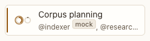

# Rail row

**Where:** Each conversation in the rail.

## Why it exists

One glance tells you who is in a conversation and what they are doing.

## Expected functionality

- Shows the agent ring(s), the conversation’s name, @handles and the most urgent status word on one line.
- A mock agent says “mock” after its @handle, in a room too (“@librarian mock, @indexer”). Moving its persona to Claude Code drops the marker without a reload (#12).
- An unread badge appears when an agent finishes while you’re elsewhere.
- The open conversation is marked (aria-current).

## Steps to reproduce

1. Run the demo (`node tools/demo.mjs --port 4180`) and open <http://127.0.0.1:4180/> while it plays; keep the tab open.
2. Watch the “Corpus planning” row while @indexer works in it.
3. Leave the conversation and let an agent finish; check the unread badge.

**Pass if:** The ring and status word follow the agent’s state, and the badge clears when you open the conversation.

## Related

- [rail](rail.md)
