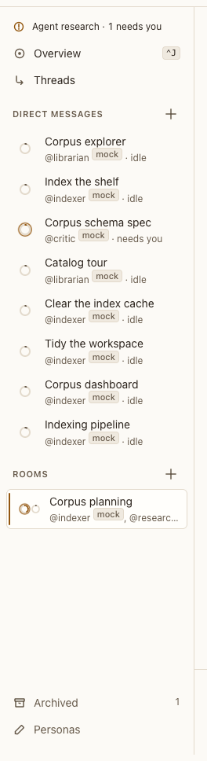

# Rail (sidebar)

**Where:** Left side, in a project.

## Why it exists

You switch between a project’s conversations constantly and need to spot a blocked agent from anywhere.

## Expected functionality

- Shows Threads (topic threads, with how many have new replies), the open conversation’s [Agents](agents-section.md) (#105), then Direct messages and Rooms, each with a “+”.
- Other projects with agents that need you are listed at the top; each opens that project.
- Personas at the bottom, with the build under it in tiny text: `vX.Y.Z · commit`, the version from package.json and the commit Postbox runs from (`POSTBOX_COMMIT`, or the git checkout).
- Hidden and shown with the sidebar toggle or ⌘\.

## Steps to reproduce

1. Run the demo (`node tools/demo.mjs --port 4180`) and open <http://127.0.0.1:4180/> while it plays; keep the tab open.
2. Open a project and check the sections. In a conversation, Agents lists its agents, above Direct messages.
3. Use “+” beside Direct messages and beside Rooms (cancel each).
4. Open Threads.

**Pass if:** All sections are present, each “+” opens the right sheet, and Threads lists the project’s topic threads.

## Related

- [rail row](rail-row.md)
- [agents section](agents-section.md)
