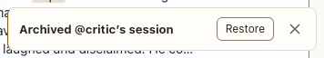

# Toast

**Where:** Top right, after actions and blocking events.

## Why it exists

Confirms what just happened and offers a next step (Restore, Go) without a dialog.

## Expected functionality

- Appears in the Notifications region for permission requests and other blocking events from other conversations. A delete has no toast and no Undo: its confirm said what goes.
- Notices share one top-right stack of at most three, newest first; on a narrow screen it spans the available width.
- Has an action button when one applies; disappears on its own; is announced to screen readers.

## Steps to reproduce

1. Run the demo (`node tools/demo.mjs --port 4180`) and open <http://127.0.0.1:4180/> while it plays; keep the tab open.
2. Press ⌃J while nothing needs you, then wait for an agent in another conversation to need you.

**Pass if:** Both notices appear in the same top-right Notifications stack, the newest first, and each disappears on its own.
