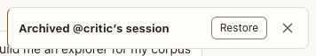

# Toast

**Where:** Bottom right, after actions and blocking events.

## Why it exists

Confirms what just happened and offers the way back (Undo, Restore, Go) without a dialog.

## Expected functionality

- Appears after archive, delete (with a countdown and Undo), permission requests and other blocking events from other conversations.
- Has an action button when one applies; disappears on its own; is announced to screen readers.

## Steps to reproduce

1. Run the demo (`node tools/demo.mjs --port 4180`) and open <http://127.0.0.1:4180/> while it plays; keep the tab open.
2. From the overview, archive a session from its card menu.
3. Press Restore in the toast before it disappears.

**Pass if:** The toast appears, Restore works, and the session is back.
