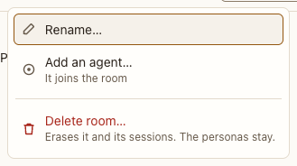

# Conversation menu

**Where:** Top bar, “⋯” beside the agents’ rings, in a conversation.

## Why it exists

Conversations need to be renamed, grown into rooms and deleted without leaving the conversation.

## Expected functionality

- Rename… opens the [rename sheet](../../sheets/rename.md).
- Add an agent… opens the [new-agent sheet](../../sheets/new-agent.md) joined to this conversation; a direct message becomes a room.
- Permissions… opens the [permissions panel](../permissions-panel.md) for the agent the composer replies to; in a room, it offers the others.
- Under Agent (or Agents, in a room), one line per agent: its @name, then its backend, model, effort and state as text, with full model ids (“@indexer · Claude Code · claude-sonnet-5-5 · not the model you set: claude-opus-5-5 · medium effort · idle”). Choosing one opens its persona (#60). A mock agent says “mock” after its name (#12).
- Delete conversation… (or Delete room…) opens the [delete confirm](../../sheets/delete-conversation.md).
- A sheet opened from the menu returns focus to ⋯ when it closes, including by Escape (#26).

## Steps to reproduce

1. Run the demo (`node tools/demo.mjs --port 4180`) and open <http://127.0.0.1:4180/> while it plays; keep the tab open.
2. Open “Corpus explorer”, open ⋯, and try each item, cancelling each sheet.

**Pass if:** Each item opens the right sheet, and Cancel leaves everything unchanged. Each agent’s line says what its row in the sidebar’s Agents section says, with full model ids.

## Related

- [top bar](top-bar.md)
