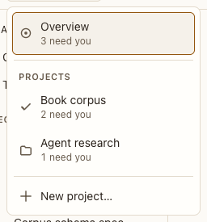

# Postbox menu

**Where:** Top bar, the Postbox mark.

## Why it exists

Projects are switched rarely, so they live in one menu that works from anywhere, instead of tabs or a rail switcher.

## Expected functionality

- Lists every project (with how many agents need you there, or its folder), and New project….
- Every project has the same folder icon. The current project is focused when the menu opens, highlighted, marked with a trailing check, and exposed as `aria-current`.
- Choosing a project opens the conversation you were last in there, or its latest one; a project without conversations shows an empty page with New conversation and New agent.
- The menu is keyboard operable (arrow keys, Enter, Escape) and returns focus to the mark when closed.
- Clicking the mark again closes the menu and sets `aria-expanded` to “false”. Every menu (⋯, +) works the same way (#29).

## Steps to reproduce

1. Run the demo (`node tools/demo.mjs --port 4180`) and open <http://127.0.0.1:4180/> while it plays; keep the tab open.
2. From a conversation in “Book corpus”, open the Postbox menu and choose “Agent research”.
3. Open a conversation there, then go to “Book corpus” and back to “Agent research” through the menu.
4. Open the menu with the keyboard (Tab to the mark, Enter) and close it with Escape.

**Pass if:** The menu opens and closes by mouse and keyboard. From each project, that project is focused, highlighted, checked and current when the menu opens, and choosing a project opens the conversation you last had there.

## Related

- [top bar](top-bar.md)
