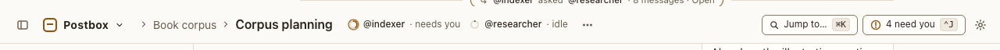

# Top bar

**Where:** Every view, across the top.

## Why it exists

It answers “where am I, who is here, and what needs me?” from anywhere: the path to the open conversation, a ring for each agent in it, and the global actions. What each agent is doing and runs with is in the sidebar’s [Agents section](../rail/agents-section.md) (#105), so the title and the project have room.

## Expected functionality

- The sidebar toggle (left) hides and shows the rail; ⌘\ does the same, and the choice is remembered after a reload.
- The Postbox mark opens the places menu (see [Postbox menu](postbox-menu.md)).
- Breadcrumbs read Project › Conversation; the project crumb opens that project, and Overview is a link when you’re elsewhere.
- Each agent in the conversation has a ring, which follows its state live. The ring is a button: its name is the ring’s label, the agent’s name and state (“@indexer: Idle, 12% of context used”), and it opens the agent’s [quick panel](../rail/agents-section.md) (#105), for when the sidebar is hidden or the window is narrow.
- With two agents in a room at 1280 px, the conversation’s title and the project show in full (#105).
- At any width, nothing in the top bar overflows or runs under anything else (#72). When it doesn’t fit, it drops, in order: the project above the conversation’s title, the demo banner’s sentence (it folds to “Demo”), and last the rings fold into one stack of rings. The stack’s name is every ring’s label, and it opens a menu of the agents, each with its state and what it runs with, which leads to its quick panel. The title keeps about 100 px before anything drops for it. Postbox measures what fits, so it depends on the window’s width and on how many agents there are, not on a fixed breakpoint, and everything comes back when there’s room again. What each agent runs with is also in its overview card and in the conversation’s ⋯ menu, as text.
- “⋯” opens the [conversation menu](conversation-menu.md).
- “Jump to… ⌘K” opens the [command palette](../command-palette.md).
- The needs-you button counts agents waiting on you; it is disabled with “Nothing needs you” when none are, and ⌃J goes to the next one and focuses what it’s waiting on.
- The gear opens Settings.
- Under `--demo`, “Demo mode: scripted agents” sits beside “Jump to…” on every view: overview, project, Threads, conversation and Archived (#12). It can’t be closed; where room is short it folds to “Demo”, and a screen reader still reads the whole sentence. It isn’t a live region. Without `--demo` it isn’t there.

## Steps to reproduce

1. Run the demo (`node tools/demo.mjs --port 4180`) and open <http://127.0.0.1:4180/> while it plays; keep the tab open.
2. Open “Corpus planning” (a room) from the rail.
3. Check the breadcrumbs: Book corpus › Corpus planning, in full, and a ring for each of its two agents.
4. Send “@indexer index the shelf” and watch @indexer’s ring change as it works. Tab to the ring and press Enter: its quick panel opens; Escape returns to the ring.
5. Press ⌘\ twice; reload in between and check the rail state persists.
6. Press ⌃J while something needs you.
7. Add two more agents to “Corpus planning” (⋯ › Add an agent…), so it has four. Narrow the window from full width to its narrowest, then widen it again.

**Pass if:** Every item above behaves as described, and the rings change within a second of the agent’s state. The demo banner shows on every view. In step 7, the top bar never overflows, every agent is reachable from a ring or the stack, the parts drop and come back in the order above, and ⋯ lists each agent’s backend, model, effort and state at every width. `node tools/check-header.mjs` passes.

## Related

- [postbox menu](postbox-menu.md)
- [conversation menu](conversation-menu.md)
- [rail](../rail/rail.md)
- [agents section and quick panel](../rail/agents-section.md)
